# Recomendação de músicas com Neo4j

Sistema de recomendação de faixas musicais modelado como grafo de propriedades no Neo4j, construído sobre o catálogo público *Spotify Tracks Dataset* (Kaggle) e enriquecido com dados sintéticos de usuários, interações e rede social. O repositório contém o modelo, os scripts de carga em Cypher, as consultas de negócio, a avaliação offline das estratégias de recomendação e as evidências visuais geradas no Neo4j Browser.

## Sumário

1. [Contexto do problema](#1-contexto-do-problema)
2. [Justificativa para o uso de grafos](#2-justificativa-para-o-uso-de-grafos)
3. [Dados](#3-dados)
4. [Modelo do grafo](#4-modelo-do-grafo)
5. [Carga (scripts Cypher)](#5-carga-scripts-cypher)
6. [Relacionamentos derivados](#6-relacionamentos-derivados)
7. [Perguntas de negócio e evidências](#7-perguntas-de-negócio-e-evidências)
8. [Avaliação offline](#8-avaliação-offline)
9. [Execução](#9-execução)
10. [Troubleshooting](#10-troubleshooting)
11. [Limitações e trabalhos futuros](#11-limitações-e-trabalhos-futuros)
12. [Estrutura do repositório](#12-estrutura-do-repositório)

---

## 1. Contexto do problema

Plataformas de streaming precisam sugerir, para cada usuário, faixas que ele ainda não ouviu e que tenham alta probabilidade de serem aceitas. As abordagens usuais são:

| Abordagem | Sinal utilizado | Limitação típica |
|---|---|---|
| Filtragem colaborativa | coocorrência de consumo entre usuários | não atende usuários ou itens sem histórico (*cold start*) |
| Baseada em conteúdo | atributos do item (gênero, atributos de áudio) | tende a recomendar itens muito parecidos entre si |
| Social | preferências de usuários conectados | depende da densidade da rede |
| Híbrida | combinação das anteriores | exige calibração dos pesos |

O desafio consiste em modelar um domínio musical no Neo4j que suporte as quatro abordagens, implementá-las em Cypher e demonstrar seu funcionamento com consultas e visualizações.

## 2. Justificativa para o uso de grafos

1. **As recomendações são consultas de vizinhança.** Filtragem colaborativa é a travessia `Usuário → Faixa ← Usuário → Faixa`; recomendação social é `Usuário → Usuário → Faixa`. Em um banco relacional, cada salto corresponde a um *join* sobre tabelas de interação com dezenas de milhares de linhas; no Neo4j, cada salto segue ponteiros a partir dos nós já visitados (*index-free adjacency*), e o custo depende do tamanho da vizinhança, não do tamanho das tabelas.
2. **Sinais heterogêneos convivem no mesmo modelo.** Escutas, curtidas, follows, playlists, gêneros e similaridade de áudio são tipos de relacionamento distintos sobre os mesmos nós. Combinar sinais (seção 7, Q6) é uma união de padrões, sem necessidade de pipelines separados.
3. **Explicabilidade.** O caminho que gerou a recomendação é o próprio resultado da consulta e pode ser exibido ao usuário ("porque usuários parecidos com você ouviram X").
4. **Algoritmos de grafo disponíveis no próprio banco.** O plugin Graph Data Science (GDS) fornece similaridade de nós, detecção de comunidades e centralidade, que foram usados para materializar relacionamentos derivados (seção 6).
5. **Evolução do esquema.** Novos sinais (por exemplo, `SKIPPED`, eventos de shows) entram como novos tipos de relacionamento sem migração das estruturas existentes.

## 3. Dados

### 3.1 Catálogo: Spotify Tracks Dataset (Kaggle)

- Fonte: [kaggle.com/datasets/maharshipandya/-spotify-tracks-dataset](https://www.kaggle.com/datasets/maharshipandya/-spotify-tracks-dataset) (licença BSD).
- Download reprodutível sem credenciais: espelho publicado pelo mesmo autor no Hugging Face (`maharshipandya/spotify-tracks-dataset`), usado por [`scripts/download_dataset.py`](scripts/download_dataset.py).
- Arquivo: `dataset.csv`, 114.000 linhas, 21 colunas (id, artistas, álbum, nome, popularidade, duração, explícito, 11 atributos de áudio e gênero).
- Amostra versionada: [`data/sample/spotify_tracks_sample.csv`](data/sample/spotify_tracks_sample.csv) (300 linhas, amostragem sistemática que cobre todos os gêneros).

Perfil do arquivo, obtido antes da modelagem:

| Medida | Valor |
|---|---:|
| Linhas | 114.000 |
| `track_id` distintos | 89.741 |
| `track_id` presentes em mais de um gênero | 16.641 (até 9 gêneros) |
| `track_id` com popularidade divergente entre linhas | 720 |
| Linhas sem artista/álbum/nome | 1 |
| Gêneros distintos | 114 |
| Artistas distintos (após separar por `;`) | 29.858 |
| Nomes de álbum distintos / pares (álbum, artista principal) | 46.590 / 57.637 |
| Pares (nome, artista principal) com mais de um `track_id` | 4.906 (13.670 faixas) |

### 3.2 Dados sintéticos de interação

O dataset contém apenas catálogo. [`scripts/generate_seed.py`](scripts/generate_seed.py) gera, com semente fixa (`SEED = 42`), os sinais de interação necessários. O gerador segue premissas explícitas para que os sinais tenham estrutura, e não sejam ruído uniforme:

- cada usuário tem um gênero-âncora e 1 a 3 gêneros vizinhos, definidos pela distância euclidiana entre os centróides de atributos de áudio dos gêneros;
- o país do usuário influencia o gênero-âncora com probabilidade 0,5 (ex.: BR → `mpb`, `sertanejo`, `pagode`, ...);
- dentro de um gênero, a faixa é amostrada sem reposição entre as 150 mais populares, com peso `(popularidade + 1)^1,5`; 5% das escolhas são de gênero aleatório;
- o número de reproduções segue distribuição exponencial, maior no gênero-âncora;
- a probabilidade de curtida é `min(0,85; 0,05 + playCount/25)`;
- 70% dos *follows* ligam usuários que compartilham gênero (homofilia);
- 60 usuários recém-cadastrados possuem apenas preferências declaradas (*cold start*);
- 20% das escutas de 300 usuários são retidas em `holdout_listens.csv` e não são carregadas no grafo (seção 8).

| Arquivo | Linhas | Destino no grafo |
|---|---:|---|
| `users.csv` | 2.060 | `(:User)` |
| `prefers.csv` | 3.090 | `(:User)-[:PREFERS]->(:Genre)` |
| `listens.csv` | 78.719 | `(:User)-[:LISTENED {playCount, lastPlayed}]->(:Track)` |
| `likes.csv` | 27.091 | `(:User)-[:LIKED {likedAt}]->(:Track)` |
| `follows.csv` | 17.189 | `(:User)-[:FOLLOWS {since}]->(:User)` |
| `playlists.csv` | 1.414 | `(:User)-[:CREATED]->(:Playlist)` |
| `playlist_tracks.csv` | 26.865 | `(:Playlist)-[:CONTAINS {position}]->(:Track)` |
| `holdout_listens.csv` | 2.552 | não carregado (avaliação) |

Amostras de cada arquivo (300 linhas) estão em [`data/sample/`](data/sample/). Os arquivos completos são regenerados pelos scripts e não são versionados.

## 4. Modelo do grafo

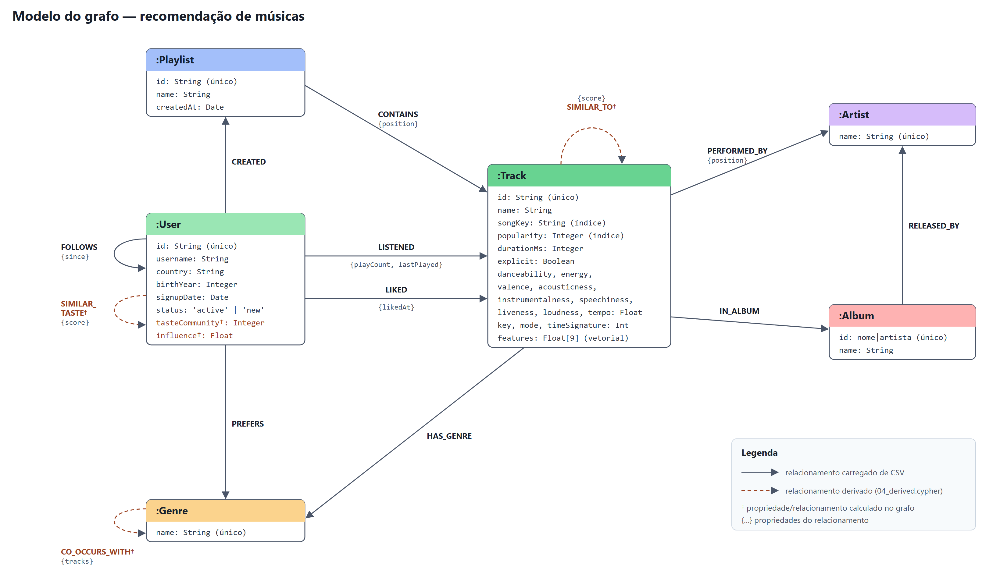

Fonte editável: [`docs/model/model.svg`](docs/model/model.svg). O mesmo modelo em formato JSON do [Arrows.app](https://arrows.app/) está em [`docs/model/model.arrows.json`](docs/model/model.arrows.json) (importável pelo menu *Import* do Arrows.app).

Esquema extraído do banco carregado com `CALL db.schema.visualization()`:

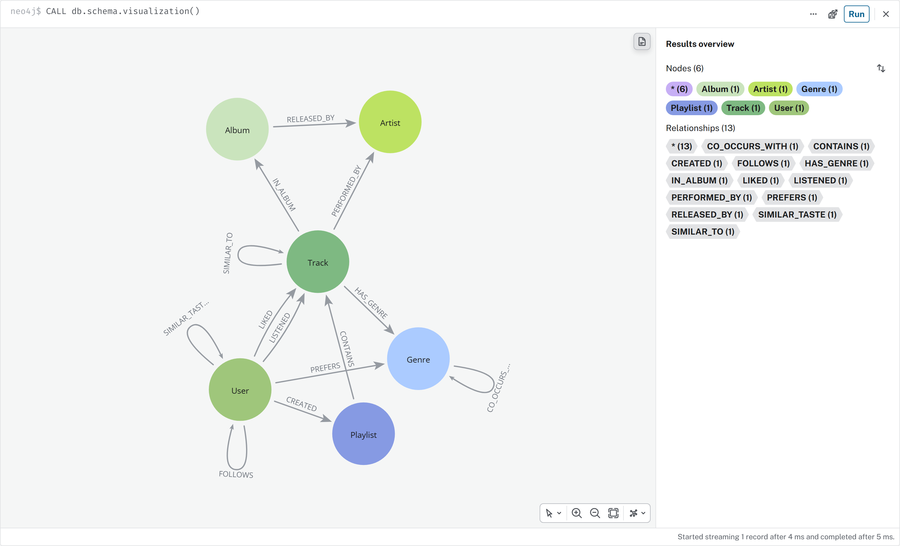

### 4.1 Nós

| Label | Chave | Quantidade | Observações |
|---|---|---:|---|
| `Track` | `id` (Spotify) | 89.740 | atributos de áudio tipados; `songKey` = nome + artista principal normalizados; `features` = vetor de 9 dimensões em [0,1] |
| `Album` | `id` = `nome\|artista principal` | 57.637 | nome de álbum isolado não é único |
| `Artist` | `name` | 29.858 | o dataset não fornece id de artista |
| `User` | `id` | 2.060 | `tasteCommunity` e `influence` são derivados |
| `Playlist` | `id` | 1.414 | |
| `Genre` | `name` | 114 | |

### 4.2 Relacionamentos

| Tipo | Origem → destino | Propriedades | Quantidade | Origem do dado |
|---|---|---|---:|---|
| `SIMILAR_TO` | Track → Track | `score` | 896.521 | derivado (índice vetorial) |
| `PERFORMED_BY` | Track → Artist | `position` (1 = principal) | 123.424 | catálogo |
| `HAS_GENRE` | Track → Genre | | 113.549 | catálogo |
| `IN_ALBUM` | Track → Album | | 89.740 | catálogo |
| `LISTENED` | User → Track | `playCount`, `lastPlayed` | 78.719 | seed |
| `RELEASED_BY` | Album → Artist | | 57.637 | catálogo |
| `SIMILAR_TASTE` | User → User | `score` | 39.544 | derivado (GDS) |
| `LIKED` | User → Track | `likedAt` | 27.091 | seed |
| `CONTAINS` | Playlist → Track | `position` | 26.865 | seed |
| `FOLLOWS` | User → User | `since` | 17.189 | seed |
| `PREFERS` | User → Genre | | 3.090 | seed |
| `CREATED` | User → Playlist | | 1.414 | seed |
| `CO_OCCURS_WITH` | Genre → Genre | `tracks` | 1.123 | derivado |

Total: 180.823 nós e 1.475.906 relacionamentos.

### 4.3 Decisões de modelagem

- **Escuta agregada.** `LISTENED` representa o par usuário-faixa com contagem (`playCount`), não cada evento de reprodução. Isso mantém o grafo com uma aresta por par e é suficiente para as métricas de similaridade usadas. Eventos individuais seriam modelados como nós `:Play` se houvesse necessidade de análise temporal fina.
- **Gênero como nó.** Permite travessias por gênero (cold start, afinidade, coocorrência) e o cálculo de `CO_OCCURS_WITH`. Como propriedade de lista em `Track`, essas consultas exigiriam varredura de todas as faixas.
- **Álbum com chave composta.** 46.590 nomes de álbum correspondem a 57.637 pares (nome, artista principal); nomes como "Greatest Hits" se repetem entre artistas.
- **`songKey`.** A mesma música aparece com `track_id` distintos (single, álbum, coletânea, remaster). As consultas de recomendação excluem candidatas cujo `songKey` coincide com uma faixa já ouvida, para não recomendar outra edição da mesma música.
- **Ordem de artistas.** `PERFORMED_BY.position` preserva a ordem da coluna `artists`; `position = 1` identifica o artista principal.

## 5. Carga (scripts Cypher)

Os scripts são executados em ordem por [`scripts/load.sh`](scripts/load.sh), que copia os CSVs para o diretório de import do Neo4j e chama `cypher-shell -f`.

| Script | Conteúdo | Tempo medido* |
|---|---|---:|
| [`00_reset.cypher`](cypher/00_reset.cypher) | remove dados, projeções GDS e índice vetorial (recarga idempotente) | 3 s |
| [`01_schema.cypher`](cypher/01_schema.cypher) | 6 constraints de unicidade e 2 índices | 3 s |
| [`02_load_catalog.cypher`](cypher/02_load_catalog.cypher) | `LOAD CSV` do dataset original em 6 passes | 24 s |
| [`03_load_seed.cypher`](cypher/03_load_seed.cypher) | `LOAD CSV` dos dados sintéticos | 7 s |
| [`04_derived.cypher`](cypher/04_derived.cypher) | índice vetorial, `SIMILAR_TO`, `CO_OCCURS_WITH`, GDS | 92–100 s |
| [`05_business_queries.cypher`](cypher/05_business_queries.cypher) | perguntas de negócio (Q1–Q12) | 3 s |

\* Neo4j 2026.10.0 Community, WSL2 (Ubuntu 22.04), 12 vCPU, heap 2 GB, page cache 2 GB.

Trecho representativo de [`02_load_catalog.cypher`](cypher/02_load_catalog.cypher):

```cypher
// Passe 2: faixas com atributos de áudio tipados.
// LOAD CSV entrega todos os campos como string; a conversão é explícita.
LOAD CSV WITH HEADERS FROM 'file:///music/dataset.csv' AS row
WITH row
WHERE row.track_id IS NOT NULL AND coalesce(row.artists, '') <> '' AND coalesce(row.track_name, '') <> ''
CALL (row) {
  MERGE (t:Track {id: row.track_id})
  ON CREATE SET
    t.name       = row.track_name,
    t.popularity = toInteger(row.popularity),
    t.explicit   = toBoolean(row.explicit),
    t.energy     = toFloat(row.energy),
    // ... demais atributos ...
    t.songKey    = toLower(trim(row.track_name)) + '|' + toLower(trim(split(row.artists, ';')[0]))
  ON MATCH SET   // a mesma faixa aparece em várias linhas (uma por gênero)
    t.popularity = CASE WHEN toInteger(row.popularity) > t.popularity
                        THEN toInteger(row.popularity) ELSE t.popularity END
} IN TRANSACTIONS OF 5000 ROWS;

// Passe 5: artistas múltiplos separados por ';', preservando a ordem
LOAD CSV WITH HEADERS FROM 'file:///music/dataset.csv' AS row
WITH row WHERE row.track_id IS NOT NULL AND coalesce(row.artists, '') <> ''
CALL (row) {
  MATCH (t:Track {id: row.track_id})
  WITH t, [n IN split(row.artists, ';') | trim(n)] AS names
  UNWIND range(0, size(names) - 1) AS i
  WITH t, names[i] AS name, i WHERE name <> ''
  MATCH (a:Artist {name: name})
  MERGE (t)-[r:PERFORMED_BY]->(a)
  ON CREATE SET r.position = i + 1
} IN TRANSACTIONS OF 5000 ROWS;
```

A carga do catálogo é dividida em passes (gêneros, faixas, `HAS_GENRE`, artistas, `PERFORMED_BY`, álbuns). Combinar na mesma instrução `MERGE` de nós de labels diferentes e de relacionamentos faz o planejador inserir o operador `Eager`, que materializa todas as linhas antes de escrever e anula o efeito de `IN TRANSACTIONS`. Ler o arquivo seis vezes custa menos do que manter 114 mil linhas e seus efeitos em uma única transação.

## 6. Relacionamentos derivados

Definidos em [`cypher/04_derived.cypher`](cypher/04_derived.cypher).

| Elemento | Método | Parâmetros |
|---|---|---|
| `(:Track)-[:SIMILAR_TO {score}]->(:Track)` | índice vetorial HNSW sobre `Track.features`; 10 vizinhos por faixa, excluindo o mesmo `songKey` | 9 dimensões, distância euclidiana |
| `(:Genre)-[:CO_OCCURS_WITH {tracks}]->(:Genre)` | contagem de faixas classificadas nos dois gêneros | gravado uma vez por par (`g1.name < g2.name`) |
| `(:User)-[:SIMILAR_TASTE {score}]->(:User)` | GDS Node Similarity (Jaccard) sobre o grafo bipartido User–LISTENED–Track | `topK = 20`, `similarityCutoff = 0,02` |
| `User.tasteCommunity` | GDS Louvain sobre `SIMILAR_TASTE`, ponderado por `score` | `concurrency = 1`; 14 comunidades, modularidade ≈ 0,784 |
| `User.influence` | GDS PageRank sobre `FOLLOWS` | `dampingFactor = 0,85`, 30 iterações |

O vetor `features` é composto por `danceability`, `energy`, `valence`, `acousticness`, `instrumentalness`, `speechiness`, `liveness`, `tempo/250` e `(loudness + 60)/60`, limitados a [0,1]. Sem a normalização, `tempo` (≈ 50–220) e `loudness` (≈ −50–0) dominariam a distância. A distância euclidiana foi preferida ao cosseno porque, com todos os componentes não negativos, a similaridade de cosseno concentra-se perto de 1 e discrimina pouco.

## 7. Perguntas de negócio e evidências

Todas as consultas estão em [`cypher/05_business_queries.cypher`](cypher/05_business_queries.cypher). Parâmetros de demonstração: `userId = 'u00029'` (usuário BR, 43 faixas ouvidas, preferências declaradas `pagode` e `mpb`), `coldUserId = 'u02002'` (usuário novo, sem histórico) e `trackId = '2SZWtoroRuSM60jzsXqVc9'` ("Vem Morena").

As imagens foram geradas no Neo4j Browser servido pelo próprio servidor (`http://localhost:7474/browser/`) por [`scripts/capture_screenshots.py`](scripts/capture_screenshots.py).

| # | Pergunta | Técnica |
|---|---|---|
| Q1 | Qual o perfil de escuta do usuário? | agregação por gênero |
| Q2 | Que faixas ouvem os usuários com histórico parecido? | filtragem colaborativa, Jaccard na consulta |
| Q3 | Idem, com vizinhança pré-computada | filtragem colaborativa, `SIMILAR_TASTE` (GDS) |
| Q4 | Que faixas soam parecido com as favoritas do usuário? | conteúdo, `SIMILAR_TO` + afinidade de gênero |
| Q5 | O que curtem as pessoas que o usuário segue? | social |
| Q6 | Qual a recomendação final, e por quê? | híbrida ponderada, com fontes |
| Q7 | O que recomendar a um usuário sem histórico? | cold start por `PREFERS` + prova social |
| Q8 | Quem ouviu esta faixa também ouviu...? | item-item, cosseno de ouvintes |
| Q9 | Quais gêneros do catálogo se sobrepõem? | `CO_OCCURS_WITH` |
| Q10 | Quais artistas transitam entre mais gêneros? | grau por gênero |
| Q11 | Quais segmentos de ouvintes existem? | Louvain |
| Q12 | Quem são os usuários mais influentes? | PageRank |

### Q1. Perfil de escuta

```cypher
MATCH (u:User {id: $userId})-[l:LISTENED]->(:Track)-[:HAS_GENRE]->(g:Genre)
RETURN g.name AS genre, count(*) AS tracks, sum(l.playCount) AS plays
ORDER BY plays DESC LIMIT 10;
```

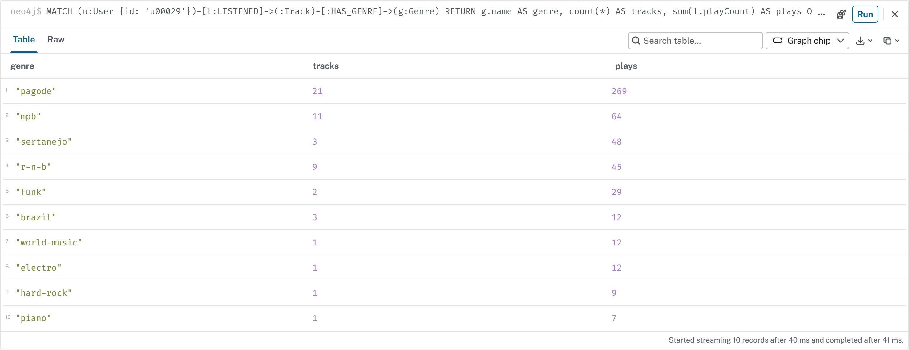

Subgrafo correspondente (15 faixas mais tocadas e seus gêneros):

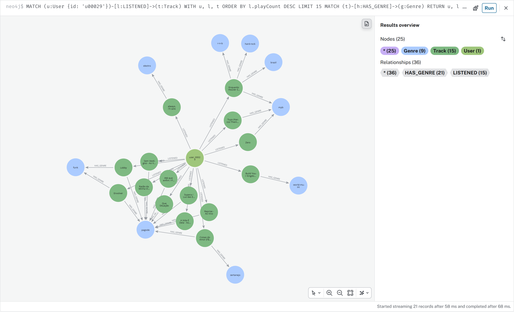

Resultado: o histórico de `u00029` concentra-se em `pagode` (269 reproduções), seguido de `mpb`; os demais gêneros têm baixa participação, coerente com o perfil declarado.

### Q2. Filtragem colaborativa (Jaccard calculado na consulta)

```cypher
MATCH (u:User {id: $userId})-[:LISTENED]->(t:Track)<-[:LISTENED]-(other:User)
WITH u, other, count(DISTINCT t) AS shared
WITH u, other, shared,
     COUNT { (u)-[:LISTENED]->() } AS sizeU, COUNT { (other)-[:LISTENED]->() } AS sizeO
WITH u, other, toFloat(shared) / (sizeU + sizeO - shared) AS jaccard
ORDER BY jaccard DESC LIMIT 25
MATCH (other)-[l:LISTENED]->(rec:Track)
WHERE NOT (u)-[:LISTENED]->(rec)
  AND NOT EXISTS { (u)-[:LISTENED]->(h:Track) WHERE h.songKey = rec.songKey }
WITH rec, sum(jaccard * log(1 + l.playCount)) AS score, count(other) AS neighbors
ORDER BY score DESC LIMIT 10
MATCH (rec)-[:PERFORMED_BY {position: 1}]->(a:Artist)
RETURN rec.name AS track, a.name AS artist, round(score, 3) AS score, neighbors;
```

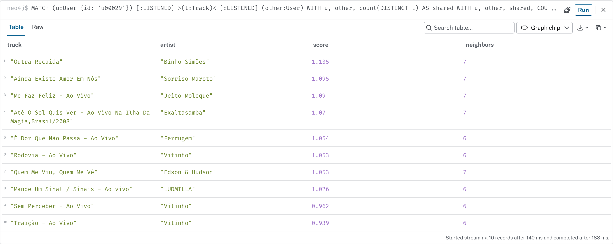

### Q3. Filtragem colaborativa com `SIMILAR_TASTE`

```cypher
MATCH (u:User {id: $userId})-[s:SIMILAR_TASTE]->(other:User)-[l:LISTENED]->(rec:Track)
WHERE NOT (u)-[:LISTENED]->(rec)
  AND NOT EXISTS { (u)-[:LISTENED]->(h:Track) WHERE h.songKey = rec.songKey }
WITH rec, sum(s.score * log(1 + l.playCount)) AS score, count(other) AS neighbors
ORDER BY score DESC LIMIT 10
MATCH (rec)-[:PERFORMED_BY {position: 1}]->(a:Artist)
RETURN rec.name AS track, a.name AS artist, round(score, 3) AS score, neighbors;
```

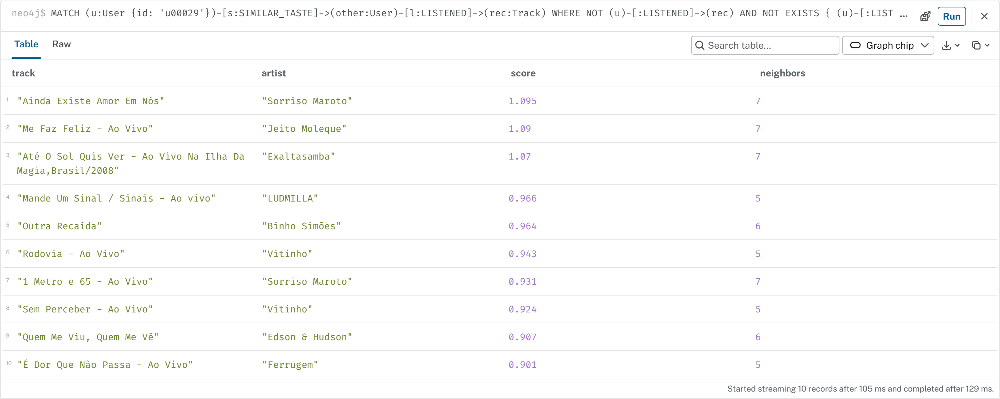

Q2 e Q3 retornam 9 das 10 faixas em comum. A explicação da recomendação "Ainda Existe Amor Em Nós" é o próprio subgrafo: os vizinhos de gosto de `u00029` (`SIMILAR_TASTE`), as faixas que compartilham com ele e a faixa recomendada, ouvida por todos eles:

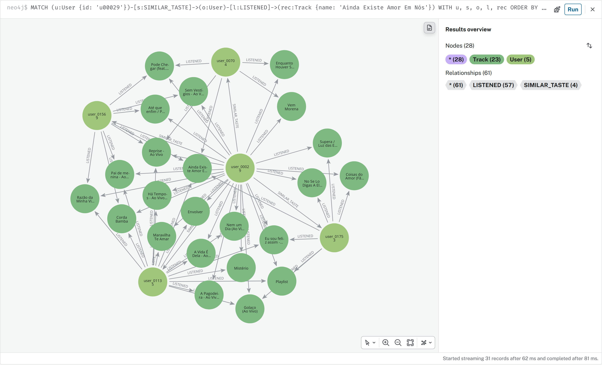

### Q4. Recomendação baseada em conteúdo

```cypher
MATCH (u:User {id: $userId})-[l:LISTENED]->(fav:Track)
WITH u, fav ORDER BY l.playCount DESC LIMIT 10
MATCH (fav)-[s:SIMILAR_TO]->(rec:Track)
WHERE NOT (u)-[:LISTENED]->(rec)
  AND NOT EXISTS { (u)-[:LISTENED]->(h:Track) WHERE h.songKey = rec.songKey }
WITH u, rec, sum(s.score) AS sim, collect(fav.name)[..2] AS because
WITH rec, sim, because,
     toFloat(COUNT { (u)-[:LISTENED]->(x:Track)
                     WHERE EXISTS { (x)-[:HAS_GENRE]->(:Genre)<-[:HAS_GENRE]-(rec) } })
     / COUNT { (u)-[:LISTENED]->() } AS affinity
WITH rec, because, sim, affinity, sim + affinity AS score
ORDER BY score DESC, rec.popularity DESC LIMIT 10
MATCH (rec)-[:PERFORMED_BY {position: 1}]->(a:Artist)
RETURN rec.name AS track, a.name AS artist, round(sim, 3) AS sim,
       round(affinity, 3) AS affinity, round(score, 3) AS score, because;
```

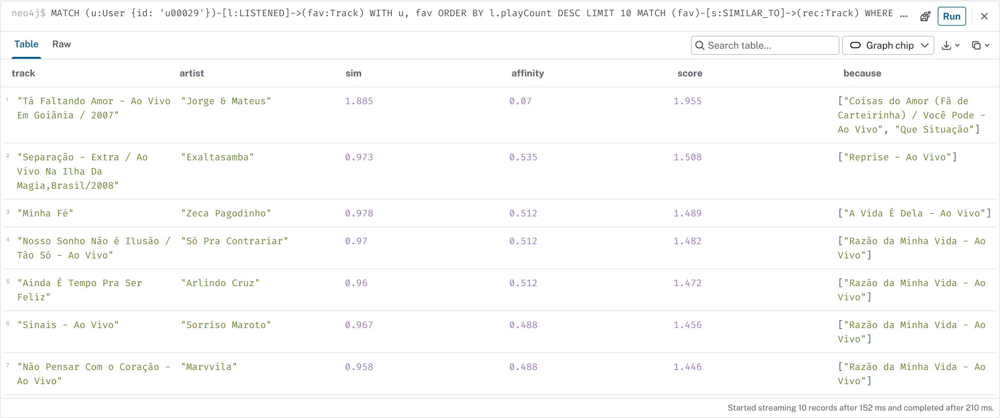

O termo `affinity` (fração das faixas ouvidas pelo usuário que compartilham gênero com a candidata) foi introduzido após a primeira versão retornar faixas de trilha sonora indiana para um ouvinte de pagode (ver seção 10). Vizinhança `SIMILAR_TO` das faixas chamadas "Reprise - Ao Vivo" (há duas, de artistas diferentes, por isso dois nós centrais): a maior parte dos vizinhos pertence a `samba`/`pagode`/`sertanejo`, mas há vizinhos em `bluegrass` e `afrobeat`, o que mostra a limitação de atributos de áudio isolados:

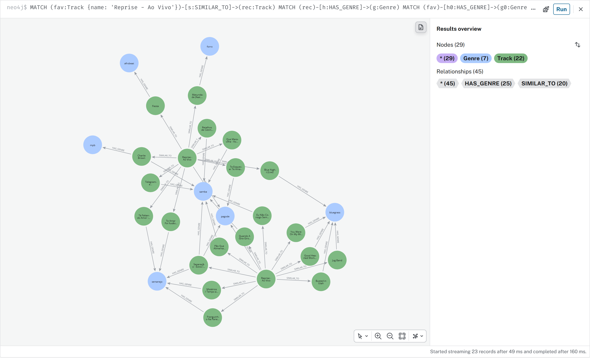

### Q5. Recomendação social

```cypher
MATCH (u:User {id: $userId})-[:FOLLOWS]->(f:User)-[:LIKED]->(rec:Track)
WHERE NOT (u)-[:LISTENED]->(rec)
WITH rec, count(f) AS friends, collect(f.username)[..3] AS likedBy
ORDER BY friends DESC, rec.popularity DESC LIMIT 10
MATCH (rec)-[:PERFORMED_BY {position: 1}]->(a:Artist)
RETURN rec.name AS track, a.name AS artist, friends, likedBy;
```

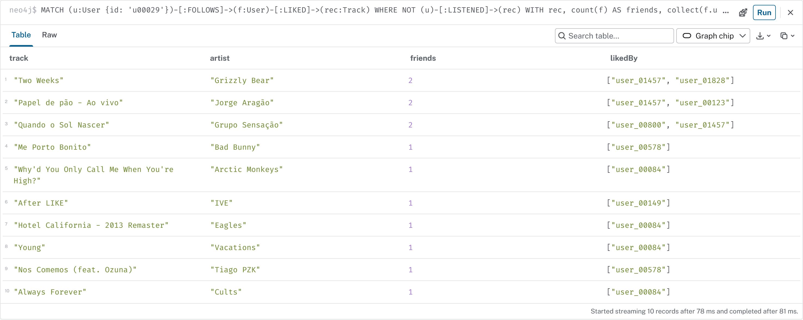

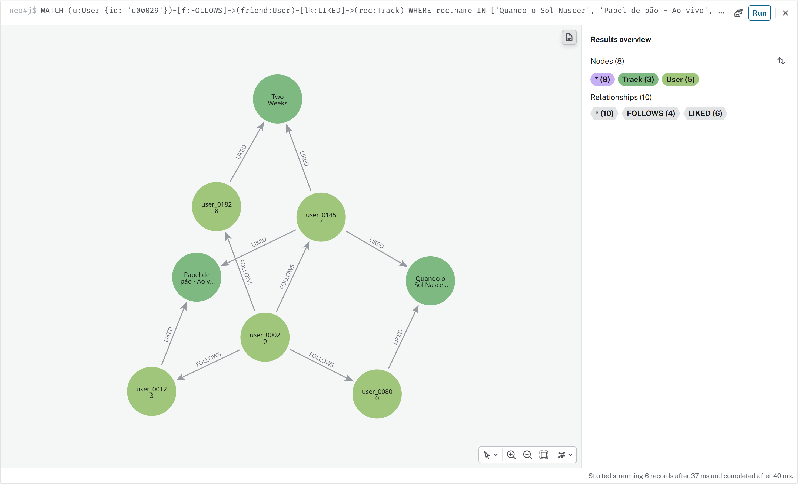

### Q6. Recomendação híbrida com explicação

Os três sinais são calculados em um `CALL` com `UNION ALL`, normalizados pelo valor máximo de cada sinal e ponderados (colaborativo 0,5; conteúdo 0,3; social 0,2). A coluna `sources` informa quais sinais sustentam cada item.

```cypher
MATCH (u:User {id: $userId})
CALL (u) {
  MATCH (u)-[s:SIMILAR_TASTE]->(:User)-[l:LISTENED]->(rec:Track)
  RETURN rec, sum(s.score * log(1 + l.playCount)) AS raw, 'collaborative' AS source
  UNION ALL
  MATCH (u)-[l:LISTENED]->(fav:Track)
  WITH u, fav ORDER BY l.playCount DESC LIMIT 10
  MATCH (fav)-[s:SIMILAR_TO]->(rec:Track)
  RETURN rec, sum(s.score) AS raw, 'content' AS source
  UNION ALL
  MATCH (u)-[:FOLLOWS]->(:User)-[:LIKED]->(rec:Track)
  RETURN rec, toFloat(count(*)) AS raw, 'social' AS source
}
WITH u, rec, raw, source
WHERE NOT (u)-[:LISTENED]->(rec)
  AND NOT EXISTS { (u)-[:LISTENED]->(h:Track) WHERE h.songKey = rec.songKey }
WITH source, collect({rec: rec, raw: raw}) AS items, max(raw) AS maxRaw
UNWIND items AS item
WITH item.rec AS rec, source,
     item.raw / maxRaw * CASE source WHEN 'collaborative' THEN 0.5
                                     WHEN 'content' THEN 0.3 ELSE 0.2 END AS weighted
WITH rec, sum(weighted) AS score, collect(source) AS sources
ORDER BY score DESC LIMIT 10
MATCH (rec)-[:PERFORMED_BY {position: 1}]->(a:Artist)
RETURN rec.name AS track, a.name AS artist, round(score, 3) AS score, sources;
```

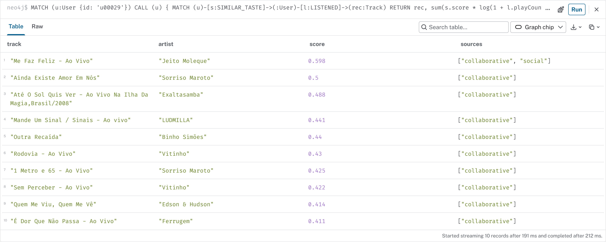

### Q7. Cold start

```cypher
MATCH (u:User {id: $coldUserId})-[:PREFERS]->(g:Genre)<-[:HAS_GENRE]-(t:Track)
WITH g, t, COUNT { (t)<-[:LIKED]-() } AS likes
ORDER BY likes DESC, t.popularity DESC
WITH g, collect({track: t, likes: likes})[..4] AS top
UNWIND top AS item
WITH g, item.track AS t, item.likes AS likes
MATCH (t)-[:PERFORMED_BY {position: 1}]->(a:Artist)
RETURN g.name AS genre, t.name AS track, a.name AS artist, likes, t.popularity AS popularity;
```

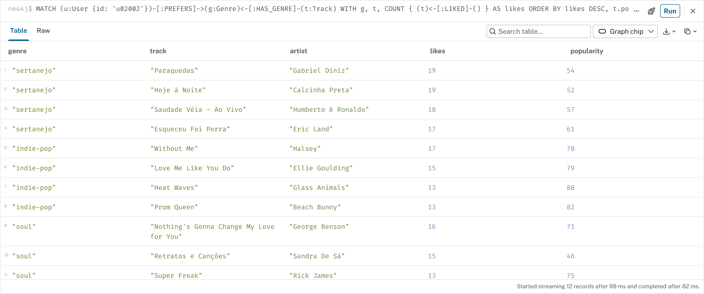

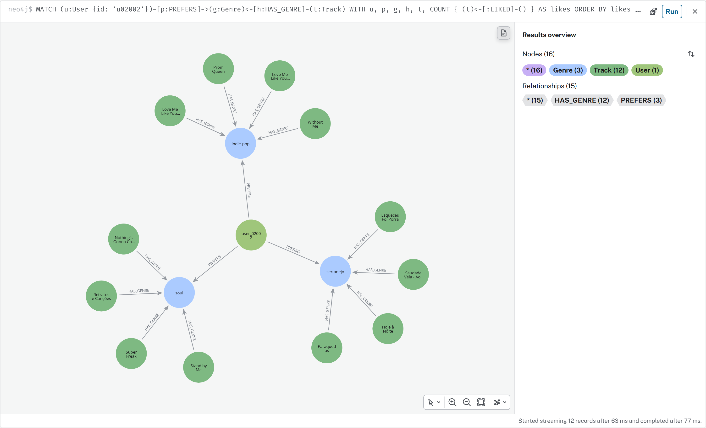

### Q8. "Quem ouviu esta faixa também ouviu"

```cypher
MATCH (t:Track {id: $trackId})<-[:LISTENED]-(u:User)-[:LISTENED]->(other:Track)
WHERE other.songKey <> t.songKey
WITH t, other, count(u) AS coListeners
WITH other, coListeners,
     toFloat(coListeners) / sqrt(COUNT { (t)<-[:LISTENED]-() } * COUNT { (other)<-[:LISTENED]-() }) AS cosine
ORDER BY cosine DESC, coListeners DESC LIMIT 10
MATCH (other)-[:PERFORMED_BY {position: 1}]->(a:Artist)
RETURN other.name AS track, a.name AS artist, coListeners, round(cosine, 3) AS cosine;
```

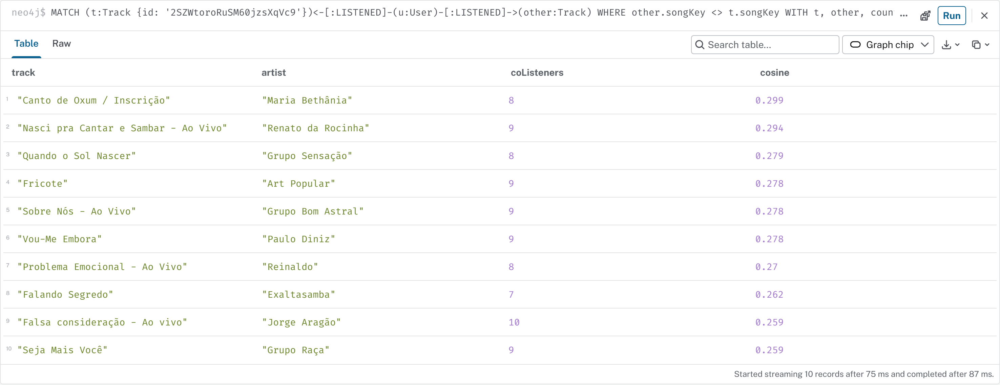

### Q9. Sobreposição de gêneros no catálogo

```cypher
MATCH (g1:Genre)-[c:CO_OCCURS_WITH]->(g2:Genre)
RETURN g1.name AS genreA, g2.name AS genreB, c.tracks AS sharedTracks
ORDER BY sharedTracks DESC LIMIT 15;
```

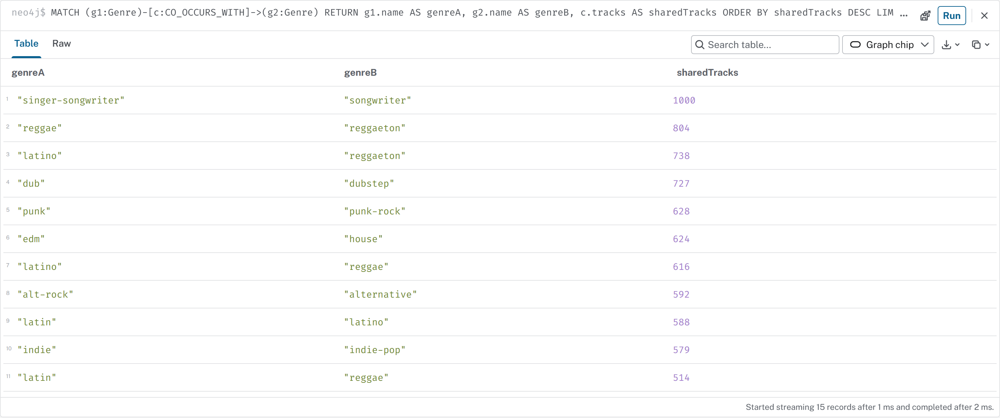

`singer-songwriter` e `songwriter` compartilham as mesmas 1.000 faixas: são o mesmo conjunto sob dois rótulos. `reggae`/`reggaeton` (804) e `dub`/`dubstep` (727) indicam que parte da classificação de gênero do dataset foi feita por correspondência de texto na busca, e não por curadoria. Esse resultado afeta a interpretação de qualquer recomendação baseada em gênero.

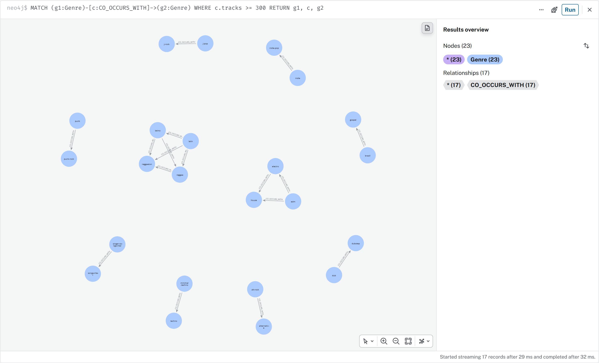

### Q10. Artistas "ponte" entre gêneros

```cypher
MATCH (a:Artist)<-[:PERFORMED_BY]-(:Track)-[:HAS_GENRE]->(g:Genre)
WITH a, collect(DISTINCT g.name) AS genres
RETURN a.name AS artist, size(genres) AS genreCount, genres[..6] AS sample
ORDER BY genreCount DESC LIMIT 10;
```

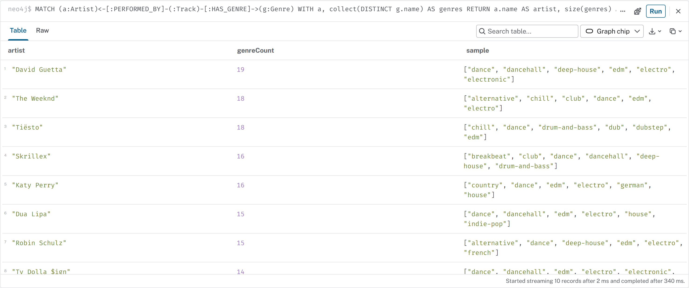

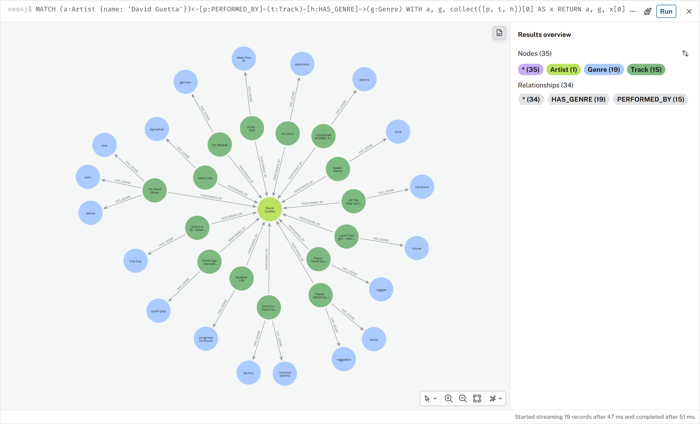

### Q11. Segmentos de ouvintes (Louvain)

```cypher
MATCH (u:User) WHERE u.tasteCommunity IS NOT NULL
WITH u.tasteCommunity AS community, count(u) AS members
MATCH (m:User {tasteCommunity: community})-[l:LISTENED]->(:Track)-[:HAS_GENRE]->(g:Genre)
WITH community, members, g.name AS genre, sum(l.playCount) AS plays
ORDER BY plays DESC
WITH community, members, collect(genre)[..4] AS topGenres
RETURN community, members, topGenres ORDER BY members DESC;
```

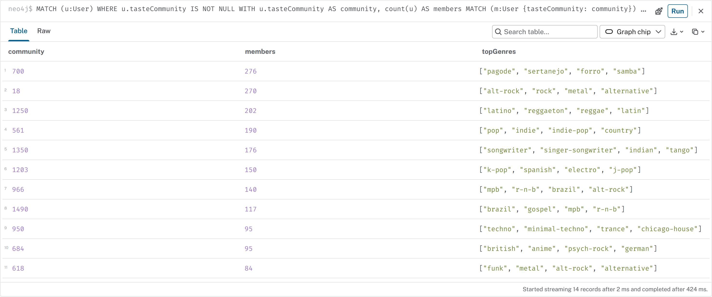

As 14 comunidades encontradas sem supervisão correspondem a famílias de gênero reconhecíveis (pagode/sertanejo/forró/samba; rock/metal; latino/reggaeton; techno/trance), o que indica que a estrutura imposta pelo gerador sintético é recuperável a partir apenas das escutas.

### Q12. Usuários influentes (PageRank)

```cypher
MATCH (u:User)
WITH u ORDER BY u.influence DESC LIMIT 10
OPTIONAL MATCH (u)-[:LIKED]->(:Track)-[:HAS_GENRE]->(g:Genre)
WITH u, g.name AS genre, count(*) AS n ORDER BY n DESC
WITH u, collect(genre)[..3] AS likedGenres
RETURN u.username AS user, u.country AS country, round(u.influence, 3) AS pageRank,
       COUNT { (u)<-[:FOLLOWS]-() } AS followers, likedGenres
ORDER BY pageRank DESC;
```

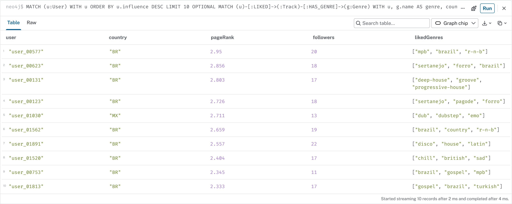

## 8. Avaliação offline

[`scripts/evaluate.py`](scripts/evaluate.py) executa cada estratégia para os 300 usuários com escutas retidas e compara as 20 primeiras recomendações com as faixas retidas. As consultas replicam Q2–Q6. O baseline de popularidade recomenda as faixas com mais ouvintes na base.

| Estratégia | HitRate@20 | Precision@20 | Recall@20 | Cobertura | Latência média (ms) |
|---|---:|---:|---:|---:|---:|
| popularidade (baseline) | 0,103 | 0,0057 | 0,0138 | 0,0003 | 1117,2 |
| popularidade por gênero | 0,410 | 0,0297 | 0,0676 | 0,0097 | 61,5 |
| colaborativa (Jaccard na consulta) | 0,457 | 0,0308 | 0,0708 | 0,0321 | 25,1 |
| colaborativa (GDS `SIMILAR_TASTE`) | **0,460** | **0,0313** | **0,0738** | 0,0332 | 19,7 |
| conteúdo (`SIMILAR_TO` + afinidade) | 0,037 | 0,0018 | 0,0050 | **0,0510** | 31,8 |
| social (curtidas de quem segue) | 0,183 | 0,0112 | 0,0273 | 0,0280 | **4,9** |
| híbrida (0,5 / 0,3 / 0,2) | 0,417 | 0,0292 | 0,0649 | 0,0372 | 19,5 |

*HitRate*: fração de usuários com ao menos um acerto. *Cobertura*: faixas distintas recomendadas / total de faixas. Latência medida pelo driver Python, incluindo rede local. Valores de uma carga completa; entre cargas, as métricas de conteúdo e do baseline variam na segunda casa decimal (ex.: HitRate de conteúdo 0,027 e 0,037), pelos motivos descritos no item 15 da seção 10.

Observações:

1. As duas variantes colaborativas têm desempenho equivalente; a versão com `SIMILAR_TASTE` pré-computado tem latência cerca de 20% menor e não depende do tamanho do histórico do vizinho no momento da consulta.
2. A recomendação por conteúdo tem o pior resultado. O gerador sintético amostra escutas por gênero e popularidade, sem relação com atributos de áudio; logo, o sinal de conteúdo não tem como prever o holdout neste conjunto de dados. Com escutas reais, o resultado tende a ser diferente. A estratégia apresenta, por outro lado, a maior cobertura de catálogo.
3. A híbrida ficou abaixo da colaborativa pura porque os pesos não foram calibrados e o sinal de conteúdo é fraco neste conjunto. Uma busca dos pesos em um conjunto de validação separado é o passo seguinte.
4. O baseline global tem latência de ~1 s porque agrega todas as 78.719 escutas a cada chamada; em produção, a popularidade seria materializada como propriedade.

Os números são relativos a dados sintéticos e servem para comparar estratégias entre si, não como estimativa de desempenho em produção.

## 9. Execução

### 9.1 Pré-requisitos

| Componente | Versão utilizada |
|---|---|
| Neo4j Community | 2026.10.0 (pacote `apt` oficial) |
| Java | OpenJDK 21 (dependência do pacote) |
| Plugins | Graph Data Science 2026.10.0, APOC core 2026.10.0 (distribuídos com o pacote) |
| Python | 3.13 |
| Pacotes Python | `neo4j` 6.x, `playwright` 1.6x (ver `requirements.txt`) |
| SO | Windows 10 + WSL2 (Ubuntu 22.04) |

### 9.2 Instalação do Neo4j (Ubuntu / WSL2)

```bash
sudo apt-get update && sudo apt-get install -y curl gnupg
curl -fsSL https://debian.neo4j.com/neotechnology.gpg.key | sudo gpg --dearmor -o /usr/share/keyrings/neo4j.gpg
echo 'deb [signed-by=/usr/share/keyrings/neo4j.gpg] https://debian.neo4j.com stable latest' | sudo tee /etc/apt/sources.list.d/neo4j.list
sudo apt-get update && sudo apt-get install -y neo4j
```

Configuração (`/etc/neo4j/neo4j.conf`):

```properties
server.default_listen_address=0.0.0.0
server.memory.heap.initial_size=2g
server.memory.heap.max_size=2g
server.memory.pagecache.size=2g
dbms.security.procedures.unrestricted=gds.*,apoc.*
```

Plugins e senha:

```bash
sudo cp /var/lib/neo4j/products/neo4j-graph-data-science-*.jar /var/lib/neo4j/labs/apoc-*-core.jar /var/lib/neo4j/plugins/
sudo systemctl stop neo4j
sudo -u neo4j neo4j-admin dbms set-initial-password musicgraph123
sudo systemctl start neo4j
```

A senha `musicgraph123` é o valor padrão usado pelos scripts para a instância local; pode ser alterada pela variável `NEO4J_PASSWORD`.

### 9.3 Dados e carga

```bash
python -m pip install -r requirements.txt
```

```bash
python scripts/download_dataset.py
```

```bash
python scripts/generate_seed.py
```

```bash
sudo bash scripts/load.sh
```

No Windows, a partir da raiz do repositório, a carga é executada dentro do WSL:

```bash
wsl -d Ubuntu -u root -- bash -c "cd /mnt/d/dio/neo4j && bash scripts/load.sh"
```

`load.sh` aceita um prefixo para executar apenas parte dos scripts (ex.: `bash scripts/load.sh 04`).

### 9.4 Consultas, avaliação e evidências

```bash
cypher-shell -u neo4j -p musicgraph123 -f cypher/05_business_queries.cypher
```

```bash
python scripts/evaluate.py --k 20
```

```bash
python -m playwright install chromium
```

```bash
python scripts/capture_screenshots.py
```

O Neo4j Browser fica disponível em `http://localhost:7474/browser/` (no Windows, o WSL2 encaminha a porta para `localhost`).

## 10. Troubleshooting

Problemas encontrados durante o desenvolvimento, na ordem em que ocorreram.

| # | Sintoma | Causa | Resolução |
|---|---|---|---|
| 1 | Download do dataset exige login | a API do Kaggle requer `kaggle.json` com token pessoal | uso do espelho público do mesmo autor no Hugging Face; o script cai para o Kaggle CLI se o espelho falhar e valida a contagem de linhas (114.000) |
| 2 | Java 17 instalado no Windows; Neo4j 2026.x requer Java 21 | incompatibilidade de versão | instalação no WSL2 via `apt`, que traz OpenJDK 21 como dependência, sem alterar o Java do Windows |
| 3 | `neo4j start` retorna "Neo4j is already running" logo após a instalação | o pacote `apt` registra e inicia o serviço `systemd` automaticamente | gerenciamento via `systemctl`; após `set-initial-password`, `systemctl restart neo4j`. O procedimento da seção 9.2 para o serviço antes de definir a senha, que é a ordem documentada pela ferramenta |
| 4 | Carga falha com `Unable to connect to localhost:7687` minutos depois de o serviço estar ativo; `uptime` mostra 0 min | o WSL2 desliga a VM da distribuição quando não há processo do Windows vinculado a ela, derrubando o Neo4j | manter uma sessão aberta (`wsl -d Ubuntu -- sleep infinity` em segundo plano) durante o uso; alternativa permanente: ajustar `vmIdleTimeout` em `%UserProfile%\.wslconfig` |
| 5 | Kaggle descreve 125 gêneros; o arquivo tem 114 | divergência entre documentação e dado | contagens do README obtidas do arquivo, não da descrição |
| 6 | 114.000 linhas geram 89.740 faixas; 720 faixas com popularidade diferente entre linhas | linha por par faixa-gênero | `MERGE` por `id`, `HAS_GENRE` por linha, `ON MATCH` mantém a maior popularidade |
| 7 | Linha 65900 sem artista, álbum e nome | registro incompleto no dataset | filtro `coalesce(row.artists, '') <> ''` em todos os passes |
| 8 | Nomes de artista contendo vírgula (`Crosby, Stills & Nash`) e aspas (`Ray "Killer" Allison`) | campo `artists` usa `;` como separador e aspas escapadas por duplicação | `split(row.artists, ';')`; o parser de `LOAD CSV` trata as aspas duplicadas sem configuração adicional |
| 9 | Recomendação por conteúdo para um ouvinte de pagode retornou faixas de trilha sonora indiana e de Jason Mraz no topo | atributos de áudio semelhantes entre gêneros distintos; o bônus inicial (+0,5 se a candidata compartilhasse *qualquer* gênero ouvido) era satisfeito por uma única faixa marginal do histórico | substituição do bônus fixo por `affinity` proporcional à fração do histórico no gênero da candidata (Q4) |
| 10 | `MATCH (item.track)-[...]` em Q7: erro `42I06 Invalid input '.'` | Cypher não aceita acesso a propriedade de mapa como padrão de nó | projetar o nó para uma variável com `WITH item.track AS t` antes do `MATCH` |
| 11 | `ModuleNotFoundError: neo4j` após `pip install neo4j` | o executável `pip` no PATH pertencia a outra instalação do Python | uso de `python -m pip`, que instala no interpretador que executa os scripts |
| 12 | Automação do Neo4j Browser: consulta enviada com texto extra e erro de sintaxe | o parser de [`capture_screenshots.py`](scripts/capture_screenshots.py) incluía o restante da linha de título `// Qn. ...` na consulta | descarte da primeira linha de cada bloco |
| 13 | Capturas de grafo pequenas e ilegíveis | o Browser 2026 (nova interface de consulta) fixa a altura da área de grafo em ~500 px e não oferece modo tela cheia por frame | painel lateral recolhido, aumento da altura do contêiner via CSS antes da captura, *zoom to fit* e `device_scale_factor = 2` |
| 14 | Grafo de coocorrência de gêneros sem rótulos | com 54 nós, o *zoom to fit* reduz a escala abaixo do limiar em que o Browser oculta legendas | filtro aumentado de `tracks >= 150` para `tracks >= 300` (23 nós) |
| 15 | Recarga completa com os mesmos CSVs produziu 13 comunidades em vez de 14, e HitRate de conteúdo 0,037 em vez de 0,027 | (a) Louvain paralelo depende da ordem de visita dos nós; (b) o índice HNSW é aproximado e sua construção não é determinística, alterando parte dos vizinhos `SIMILAR_TO`; (c) empates no `ORDER BY` do baseline são resolvidos em ordem arbitrária | Louvain com `concurrency: 1` (contagem estável em 14 nas execuções seguintes; resta variação na terceira casa da modularidade). Para (b) e (c) a variação foi aceita e documentada na seção 8; um k-NN exato (ex.: `gds.knn` com `randomSeed` e `concurrency: 1`) eliminaria (b) com custo maior |
| 16 | Reexecutar apenas `04_derived.cypher` duplicaria `SIMILAR_TASTE` (identificado na revisão do script, antes de ocorrer) | o modo `write` do GDS cria relacionamentos novos a cada execução, sem `MERGE` | remoção em lote de `SIMILAR_TASTE` antes do `nodeSimilarity.write`; verificado executando o script duas vezes seguidas (39.544 relacionamentos em ambas) |

Verificação adicional: o filtro de `songKey` em `SIMILAR_TO` foi incluído para evitar que outra edição da mesma música fosse o vizinho mais próximo. Medido em 2.000 faixas, apenas 8 de 21.840 vizinhos tinham o mesmo `songKey` (0,04%): edições diferentes geralmente têm atributos de áudio diferentes (remasterização, versão ao vivo). O filtro foi mantido por custo desprezível. O efeito relevante de `songKey` está nas consultas de recomendação, já que 4.906 músicas aparecem com mais de um `track_id`.

## 11. Limitações e trabalhos futuros

- **Dados de interação sintéticos.** As métricas da seção 8 refletem as premissas do gerador. Em particular, o desempenho da recomendação por conteúdo não é informativo. A validação com escutas reais (ex.: Last.fm 1K, Million Playlist Dataset) é necessária para conclusões sobre as estratégias.
- **Pesos da híbrida não calibrados.** Próximo passo: busca de pesos em conjunto de validação separado do holdout de teste.
- **Similaridade de conteúdo restrita a atributos de áudio.** Embeddings de texto (nome, álbum) ou de grafo (FastRP do GDS sobre `HAS_GENRE`/`PERFORMED_BY`) podem compor o vetor.
- **Taxonomia de gêneros redundante** (Q9). Uma etapa de consolidação (ex.: unir `songwriter` e `singer-songwriter`) reduziria ruído nas consultas por gênero.
- **Sinais negativos ausentes.** O modelo não registra pulos (`SKIPPED`) nem remoções de playlist.
- **Atualização incremental.** `SIMILAR_TASTE`, comunidades e PageRank são recalculados por completo; em produção seriam atualizados em janela periódica.

## 12. Estrutura do repositório

```
.
├── README.md
├── requirements.txt
├── cypher/
│   ├── 00_reset.cypher
│   ├── 01_schema.cypher
│   ├── 02_load_catalog.cypher
│   ├── 03_load_seed.cypher
│   ├── 04_derived.cypher
│   └── 05_business_queries.cypher
├── data/
│   ├── raw/        (gerado: dataset.csv do Kaggle; não versionado)
│   ├── seed/       (gerado: dados sintéticos; não versionado)
│   └── sample/     amostras de 300 linhas de cada arquivo
├── docs/
│   ├── evaluation.md          saída de scripts/evaluate.py
│   ├── img/                   modelo e capturas do Neo4j Browser
│   └── model/                 model.svg e model.arrows.json
└── scripts/
    ├── download_dataset.py
    ├── generate_seed.py
    ├── load.sh
    ├── evaluate.py
    └── capture_screenshots.py
```
